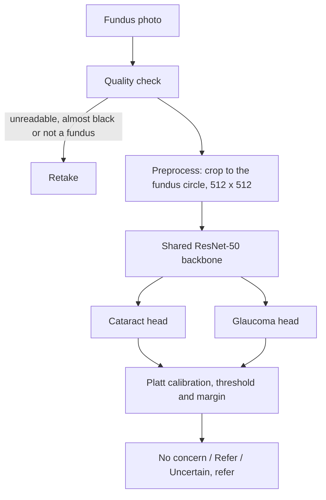

# DUAL: Dual Ocular Screener

**Cataract and glaucoma triage from a single fundus photograph.**

CS691 Capstone, Pace University, Fall 2026. Team EyeQ.

> **Research prototype, not a medical device.** DUAL helps decide who should
> see an eye specialist. It does not diagnose. The model in the live app is
> still a mock, and every patient in the app is made up.

## Contents
- [Overview](#overview)
- [How it works](#how-it-works)
- [Results](#results)
- [Live demo](#live-demo)
- [Getting started](#getting-started)
- [Reproducing the results](#reproducing-the-results)
- [Tests](#tests)
- [Project structure](#project-structure)
- [Datasets](#datasets)
- [Limitations](#limitations)
- [Team](#team)
- [Contributing](#contributing)
- [Glossary](#glossary)

## Overview
DUAL looks at one colour photo of the back of the eye (a fundus photograph) and
gives a separate result for cataract and for glaucoma:

| Result | Meaning |
|---|---|
| No concern | The score is below the threshold and not close to it. |
| Refer | The score is at or above the threshold and not close to it. Refer to a specialist. |
| Uncertain, refer | The score is too close to the threshold to call (within the margin, on either side). Refer to a specialist. |

Under the hood it is one shared ResNet-50 backbone with two binary heads
(cataract, glaucoma). The project's main result is **external validation**:
the model is trained only on ODIR-5K and tested on four datasets from other
sources. It also includes a multi-task ablation (single-disease vs shared
models), calibration with an "Uncertain, refer" result, and Grad-CAM safety
checks.

The app lets clinic staff add a patient, upload a photo for each eye, see the
result with a heatmap, and export a PDF. Terms are explained in the
[Glossary](#glossary).

## How it works

In the app, the model step is still a mock (see [Live demo](#live-demo)).

### Data
ODIR-5K is the only training data. The external sets (ORIGA, DRISHTI-GS,
ACRIMA, retina_dataset_2016) are used for testing only. Calibration, thresholds
and the uncertain cutoff are fitted on the ODIR validation split only. Sources
and approvals are under [Datasets](#datasets).

### Splits
One row per eye in `labels/eye_labels_task7.csv`. Split by patient, 70/15/15,
so both eyes of a patient are in the same split.

| Split | Eyes | Patients | Cataract | Glaucoma |
|---|---:|---:|---:|---:|
| train | 4,807 | 2,437 | 225 | 198 |
| validation | 1,024 | 522 | 46 | 39 |
| test | 1,036 | 522 | 40 | 45 |

124 eyes are `holdout` and 9 are `excluded` (see Data decisions).

External labels are in `labels/external/` (one CSV per dataset).

### Data decisions
- **Media opacity:** all 63 media-opacity eyes are held out of train, validation and test (split = holdout). They are used as the check for the cataract "haze shortcut".
- **Low image quality:** the 21 low-quality eyes are held out (split = holdout) and used to test the "Uncertain, refer" result.
- **Suspected glaucoma:** all 44 suspected-glaucoma eyes are held out. This includes 2 eyes that also have cataract (625_left, 1415_right), so they are not used as cataract examples either.
- **Fellow eyes:** when one eye is held out, the patient's other eye can still be in train, validation or test. For 28 media-opacity patients the other eye is in training, so the haze check is reported twice: on all 63 eyes, and only on eyes whose other eye was not in training.

### Models and checkpoints
Nine models: cataract-only, glaucoma-only and shared two-head, seeds 42, 43
and 44, all with the same settings. Checkpoints are not in git; they are in
GitHub releases. The settings, validation AUROCs, checkpoint hashes and release
links for all nine runs are in `results/task11/README.md`.

### Calibration and thresholds
Platt calibration, a decision threshold and an "Uncertain, refer" margin for
each model, head and seed, fitted on the validation split only. Frozen on
17 October 2026 in `results/calibration/frozen_settings.json`; the app will use
the shared model, seed 42. Details: `results/calibration/README.md`.

A score at or above the threshold is Refer, and a score too close to the
threshold (within the margin, on either side) is "Uncertain, refer". Both are
referred to a specialist.

### External evaluation
The [external evaluation protocol](documents/evaluation/external_validation_protocol.md)
defines the test-only datasets, metrics, confidence intervals and referral reporting
for SCRUM-44. It was written before external testing, and external testing uses the
calibration and decision settings frozen on 17 October 2026, unchanged. How to run
it: [external evaluation runbook](documents/evaluation/external_evaluation_runbook.md).
The frozen run and its results are in `results/external/frozen_run_20261030/`.

## Results

### Internal test
ODIR-5K test split: 1,036 eyes from 522 patients, run once after training and
calibration were frozen. AUROC, mean (SD) over seeds 42, 43 and 44:

| Condition | Shared two-head model | Single-disease model |
|---|---:|---:|
| Cataract | 0.9948 (0.0004) | 0.9910 (0.0036) |
| Glaucoma | 0.9309 (0.0125) | 0.9241 (0.0178) |

The shared model is slightly higher for both conditions, but these differences
alone do not show that one is better, and they say nothing about other
datasets. Per-seed results with 95% confidence intervals:
`results/task13/internal_results.md`.

The app uses the shared model, seed 42. On the validation split, with
"Uncertain, refer" counted as a referral, it finds 45 of 46 cataract eyes and
38 of 39 glaucoma eyes (`results/calibration/README.md`).

### External test
Four datasets from other sources, run once on 30 October 2026 with the frozen
calibration and thresholds, nothing refitted. AUROC, mean (SD) over seeds 42,
43 and 44:

| Dataset | Condition | Photos (with the condition) | Shared two-head model | Single-disease model |
|---|---|---:|---:|---:|
| ORIGA | Glaucoma | 650 (168) | 0.7487 (0.0156) | 0.7687 (0.0158) |
| DRISHTI-GS | Glaucoma | 101 (70) | 0.8820 (0.0117) | 0.8846 (0.0205) |
| ACRIMA | Glaucoma | 705 (396) | 0.5551 (0.0752) | 0.4078 (0.0952) |
| retina_dataset_2016 | Cataract | 601 (100) | 0.9099 (0.0105) | 0.9224 (0.0051) |
| retina_dataset_2016 | Glaucoma | 601 (101) | 0.7521 (0.0453) | 0.7411 (0.0541) |

- Every external result is lower than the internal test, most of all for glaucoma.
  The full internal vs external comparison is Task 17.
- ACRIMA is near or below chance. Its photos are tight crops of the optic disc,
  not full fundus photos, which may be why the model does not transfer.
- The calibrated probabilities are too low on every external set, so read the
  results as Refer or No concern, not as a real risk.
- The app model (shared, seed 42), with "Uncertain, refer" counted as a
  referral, finds 117 of 168 glaucoma photos in ORIGA, 54 of 70 in DRISHTI-GS
  and 58 of 396 in ACRIMA. In retina_dataset_2016 it finds 73 of 100 cataract
  and 73 of 101 glaucoma photos.

Per-seed results with 95% confidence intervals:
`results/external/frozen_run_20261030/external_results.md`. Notes on the run,
calibration and what the results show: `external_findings.md` in the same folder.

### Cataract haze check (Task 15)
The cataract head referred 54 of the 63 media-opacity eyes, which are graded
not cataract, and its scores rose when normal photos were blurred. This
suggests the model may react to haze or image quality, but does not prove it.
Details: `results/task15/final_haze_safety_assessment.md`.

## Live demo
- App: https://dual-eyeq-frontend.vercel.app/
- Back end API docs: https://dual-eyeq-backend.onrender.com/docs

To sign in (temporary, until the in-app login screen is added in Sprint 2):

1. Open the back end API docs. The first load can take up to a minute while
   the server wakes up.
2. Open `POST /auth/login`, click Try it out, use the body below, then click Execute:

       {"email": "demo.clinician@example.com", "password": "demo"}

3. In the same browser, open the app and use the menu to go to Upload or History.

Known limitations: reloading any page other than Home shows a 404, the doctor
name and Sign Out in the top bar are placeholders, and Safari may block the
sign-in, so use Chrome. The demo account and all patients are made up, and the
scores come from a mock model (`backend/mock_model.py`: made-up scores,
heatmaps marked "MOCK" and placeholder thresholds). The trained model and the
approved calibration settings replace it later.

## Getting started

### Requirements
- Python 3.14. The package versions in `requirements.txt` were pinned on 3.14,
  and older Python versions may fail to install them.
- Node.js with npm, for the frontend.
- A Supabase project (PostgreSQL and Storage) for the back end. Team members
  can ask for the shared one.

### Setup (one time)

    git clone https://github.com/htmw/F2026-EyeQ.git
    cd F2026-EyeQ
    python3 -m venv .venv
    source .venv/bin/activate        # Windows: .venv\Scripts\activate
    pip install -r requirements.txt

`requirements.txt` is enough for the app and its tests. To run the model
pipeline (preprocessing, training, calibration, evaluation), also install:

    pip install -r requirements-training.txt

Every time you open a new terminal to work on the project, activate again:

    source .venv/bin/activate        # Windows: .venv\Scripts\activate

Install the frontend:

    cd frontend
    npm install

### Configure the back end
The back end uses Supabase (PostgreSQL for the data, Storage for photos and
heatmaps). It reads these settings from a `.env` file in the repo folder
(copy `.env.example` to `.env` and fill it in):

    DATABASE_URL=...
    SUPABASE_URL=...
    SUPABASE_SERVICE_ROLE_KEY=...

Ask the team for the values. Never commit `.env` (git ignores it). Your local
back end uses the same shared database as the live prototype, so sign in with
the demo account above and only add made-up patients.

### Run the app
Back end (FastAPI), from the repo folder:

    uvicorn backend.main:app --reload

It runs at http://localhost:8000, with every endpoint listed at
http://localhost:8000/docs. Endpoint details: `backend/README.md`.

Frontend (React + Vite), in a second terminal:

    cd frontend
    npm run dev

It runs at http://localhost:5173.

### New database (only for a new Supabase project)
The shared database is already set up. Do this only when setting up a new
Supabase project:

1. In the Supabase SQL editor, run `database/schema.sql` on the new, empty database.
2. In Supabase Storage, create three buckets: `fundus-images`, `processed-images`
   and `heatmaps`.
3. Put the new project's values in `.env`, and add `DUAL_DEMO_PASSWORD=` with a
   password for the demo account.
4. Load the demo data (it only runs when the database has no users yet):

       python -c "from backend import seed; seed.init()"

   This adds the demo clinician `emily.geller@example.com` (with that
   password), four made-up patients and five screenings, using photos from
   `data/Internal/ODIR-5K/Training Images/`.

## Reproducing the results
All datasets are in this repo under `data/`, so everyone has the same paths after cloning:

    data/Internal/ODIR-5K/Training Images/     training data (ODIR-5K)
    data/External/ORIGA/                        test only
    data/External/DRISHTI-GS/                   test only
    data/External/ACRIMA/                       test only
    data/External/retina_dataset_2016/          test only

To check your copy of the data is complete and unchanged, run this from inside `data/`:

    shasum -a 256 -c MANIFEST.sha256

Code should use paths starting with `data/`, for example
`Path("data/Internal/ODIR-5K/Training Images")`, and be run from the repo folder.
Preprocessed copies go in `Preprocessed/`, which git ignores, since they can be rebuilt.

Run from the repo folder, in this order. Each step writes the file the next one reads.

| Step | Command | Output |
|---|---|---|
| Per-eye labels | `python scripts/build_eye_labels.py` | labels/eye_labels_task6.csv |
| Split | `python scripts/split_dataset.py` | labels/eye_labels_task7.csv |
| Check labels | `python scripts/verify_labels.py labels/eye_labels_task7.csv` | pass or fail |
| External labels | `python scripts/build_external_labels.py` | labels/external/ |
| Overlap check | `python scripts/check_dataset_overlap.py` | ODIR vs retina_dataset_2016 duplicates |
| Preprocess | `python scripts/preprocess_images.py` | Preprocessed/ (512 x 512) |
| Check preprocessing | `python scripts/verify_preprocessing.py` | preprocessing_check.jpg |
| Train cataract-only | `python scripts/train_cataract.py` | 3 seeds, results/task11/ |
| Train glaucoma-only | `python scripts/train_glaucoma.py` | 3 seeds, results/task11/ |
| Train shared model | `python scripts/train_dual_task11.py --seed 42` (then 43, 44) | results/task11/ |
| Calibration | see `results/calibration/README.md` | results/calibration/ |
| Internal test (run once, already done) | `scripts/evaluate_internal_test.py` | results/task13/ |
| External test (run once, already done) | `scripts/evaluate_external.py`, see the runbook | results/external/ |

Preprocessing is one function for ODIR and all external sets. When the fundus
circle is not found, it falls back to the largest centered square.

### Random seeds
`SEED = 42` in `src/dual/config.py` is the project seed. It made the
train/validation/test split and must not change. Training uses seeds 42, 43 and 44 for every model
type, so results can be reported as a mean over seeds. Every script starts with:

    from dual.config import set_seed
    set_seed()

Training scripts call `set_seed(seed)` for each run.

## Tests

    python -m pytest tests

The API tests (`tests/test_api.py`) need the `.env` above and run against the
shared database. Tests that need data create their own temporary clinician and
patient and delete them at the end, and Supabase Storage is replaced by a fake one in
memory, so no files are uploaded. Without `.env`, the tests that use the
database fail with "DATABASE_URL environment variable is missing".

Each model also has a smoke test in `scripts/` (for example
`python scripts/test_train_dual_task11.py`), which needs that model's
checkpoints downloaded.

## Project structure

    backend/      the API (FastAPI, Supabase PostgreSQL and Storage) with the mock model
    data/         the datasets (see Datasets)
    database/     the database tables (schema.sql), for setting up a new database
    documents/    course material, sprint files and the external evaluation protocol
    frontend/     the app (React + Vite)
    labels/       per-eye ODIR labels, the split file and external labels
    notebooks/    exploration
    results/      training (task11/), calibration (calibration/), internal test (task13/),
                  cataract haze checks (task15/) and external test (external/)
    scripts/      project code: labels, split, preprocessing, models, training, calibration, evaluation
    src/dual/     shared settings (the random seed in config.py)
    tests/        automatic checks

## Datasets

| Dataset | Used for | Photos | Source |
|---|---|---:|---|
| ODIR-5K | Training, validation, internal test | 7,000 (3,500 patients) | N. Li et al., "A benchmark of ocular disease intelligent recognition: one shot for multi-disease detection," Bench 2020, LNCS, Springer, 2021. |
| ORIGA | External test (glaucoma) | 650 | Z. Zhang et al., "ORIGA-light: an online retinal fundus image database for glaucoma analysis and research," IEEE EMBC, 2010. |
| DRISHTI-GS | External test (glaucoma) | 101 | J. Sivaswamy et al., "Drishti-GS: retinal image dataset for optic nerve head (ONH) segmentation," IEEE ISBI, 2014. |
| ACRIMA | External test (glaucoma) | 705 | A. Diaz-Pinto et al., "CNNs for automatic glaucoma assessment using fundus images: an extensive validation," BioMedical Engineering OnLine 18:29, 2019. |
| retina_dataset_2016 | External test (cataract and glaucoma) | 601 | GitHub "retina_dataset" (2016). The original repository, sjchoi86/retina_dataset, was removed; fork used: [yiweichen04/retina_dataset](https://github.com/yiweichen04/retina_dataset). No documented origin or licence. |

All datasets are used with Professor Wong's approval for non-commercial
academic research only (September 2026). He confirmed that keeping the
datasets in this repo is fine, since the project is not commercial.

## Limitations
- Glaucoma has three external test sets. External cataract testing relies on
  retina_dataset_2016 alone.
- ACRIMA photos are tight optic-disc crops, and retina_dataset_2016 has no
  documented origin or licence, so both are reported in their own rows.
- Calibration was fitted on ODIR-5K and does not transfer to the external sets.
- The cataract haze check suggests the model may react to haze or image
  quality (see Results).
- The model in the live app is still a mock.

## Team
Team EyeQ, CS691 Capstone, Pace University (advisor: Professor Wong).

| Member | Role |
|---|---|
| Anel Bazarbayeva | Scrum Master, MLOps/Integration Developer |
| Negar Kamvij | ML Developer, External Validation & Calibration |
| Shridhi Patel | Team Leader, ML Developer, Glaucoma Lead |
| Bhoami Khona | Full Stack Developer |
| Krushiben Patel | Data Pipeline, Backend Developer |
| Ansh Kevadiya | ML Developer, Cataract Lead |
| Smit Meghapara | ML Developer, Interpretability & Safety |

## Contributing
For team members:
- `develop`: everyday work goes here. All new code is reviewed on `develop` first.
- `main`: the reviewed version. Changes move from `develop` to `main` through a
  pull request once they are reviewed, as often as needed (not only at the end of a sprint).
  Never push to `main` directly.
- Task branches: create from `develop`, name after the task
  (for example `task-3-verification-script`), open the pull request into `develop`.
  Do not push to `develop` directly either.
- When opening a pull request, check the base branch before creating it.
- Wait for an approving review before merging.

## Glossary
- **Fundus photograph**: a colour photo of the back of the eye (retina and optic disc).
- **ODIR-5K**: the public dataset the models are trained on (left and right eye photos of 3,500 patients).
- **External test sets**: ORIGA, DRISHTI-GS, ACRIMA and retina_dataset_2016, from other sources, used only to test how well the model works outside ODIR.
- **Shared vs single-disease model**: one model with two heads that learns both conditions together, compared with separate models for each condition.
- **Seed**: the random starting point for training. Each model is trained with three seeds to see how much results vary.
- **AUROC**: how well the scores separate eyes with and without the condition. 0.5 is no better than chance and 1.0 is perfect.
- **Calibration**: adjusting the raw scores so they can be read as probabilities.
- **Threshold**: the score at which a result becomes Refer.
- **Uncertain, refer**: the result for a score too close to the threshold to call. These eyes are referred too.
