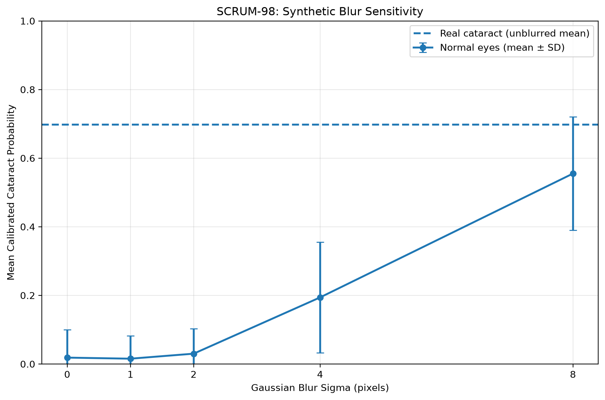

# SCRUM-98: Synthetic Blur Experiment Findings

## 1. Objective

This experiment evaluates whether the frozen cataract model responds to synthetic image blur when applied to validation images labeled as normal fundus.

The goal is to investigate possible blur sensitivity as part of SCRUM-61 (Cataract Haze Shortcut Safety Checks). An increase in cataract probability under synthetic blur may indicate sensitivity to image degradation, but it does not establish that the model relies on a clinical haze shortcut.

## 2. Experiment Configuration

The experiment follows the predefined synthetic-blur evaluation approach documented in `results/task15/haze_check_plan.md`.

- **Model:** Frozen shared ResNet50, seed 42

- **Checkpoint:** `checkpoints/task11/shared/shared_seed_42_best.pt`

- **Dataset:** ODIR validation split

- **Input images:** Preprocessed 512 × 512 RGB fundus images

- **Normal validation group:** 396 eyes

- **Real-cataract reference group:** 38 eyes

- **Gaussian blur sigma values:** 0, 1, 2, 4, and 8 pixels

- **Inference device:** CPU

- **Calibration:** Existing frozen Platt calibration

- **Model retraining:** None

Gaussian blur was applied to RGB images before tensor conversion and ImageNet normalization. The same 396 normal validation eyes were evaluated at every blur level.

The real-cataract reference group was evaluated without additional blur.

## 3. Frozen Calibration Settings

The experiment reused the approved frozen cataract calibration settings:

| Parameter | Value |
|---|---:|
| Scale | 0.963153294487912 |
| Offset | -2.9092682403195282 |
| Decision threshold | 0.05983278334695957 |
| Uncertainty margin | 0.04416100366427216 |

The experiment did not modify model weights, calibration parameters, thresholds, or predefined blur levels.

## 4. Evaluation Results

The experiment generated 2,018 predictions: 1,980 predictions from normal eyes across five blur levels and 38 predictions from the unblurred real-cataract reference group.

| Image group | Sigma | Eyes | Mean calibrated probability | Referral rate |
|---|---:|---:|---:|---:|
| Normal | 0 | 396 | 0.018503 | 10.10% |
| Normal | 1 | 396 | 0.015406 | 11.62% |
| Normal | 2 | 396 | 0.030007 | 31.06% |
| Normal | 4 | 396 | 0.193993 | 93.18% |
| Normal | 8 | 396 | 0.555002 | 100.00% |
| Real cataract | 0 | 38 | 0.697405 | 97.37% |

Referral rates include both ordinary referrals and uncertainty-based referrals.

### 4.1 Changes in Cataract Probability

For normal validation eyes, mean calibrated cataract probability increased from 0.018503 at sigma 0 to 0.555002 at sigma 8.

This represents an increase of approximately 0.5365, or 53.65 percentage points.

The response was not strictly monotonic. Mean probability decreased slightly at sigma 1 before increasing at sigma 2, 4, and 8.

### 4.2 Changes in Referral Rate

The referral rate for normal eyes increased from 10.10% without additional blur to 100.00% at sigma 8.

At sigma 4, the referral rate had already reached 93.18%.

These results indicate that strong synthetic blur substantially changes the frozen model's referral behavior on the selected normal validation images.

### 4.3 Real-Cataract Reference

The 38 unblurred real-cataract validation eyes had a mean calibrated cataract probability of 0.697405 and a referral rate of 97.37%.

This group provides a reference for interpreting the model's responses. It is not a matched clinical comparison group, and its results should not be interpreted as evidence that blurred normal eyes have developed cataracts.

## 5. Predefined Blur-Sensitivity Warning

The experiment used the warning criterion established in the evaluation plan:

**Trigger a warning if the mean calibrated cataract probability for normal eyes at sigma 8 exceeds the mean at sigma 0.**

Observed values:

- Sigma 0 mean: 0.018503

- Sigma 8 mean: 0.555002

**Result: WARNING TRIGGERED**

The increase meets the predefined criterion for possible blur sensitivity.

This is a screening result, not proof of a haze shortcut.

## 6. Visualization

The experiment generated the following comparison graph:

The graph displays mean calibrated cataract probability across the five blur levels, with standard-deviation error bars for normal eyes and a horizontal reference line showing the mean probability of unblurred real-cataract eyes.

The error bars indicate substantial variation between individual normal-eye predictions, particularly at higher blur levels.

## 7. Verification

The following checks were completed:

- Confirmed that all 434 selected validation images were available.

- Verified selection of 396 normal eyes and 38 real-cataract eyes.

- Successfully loaded the frozen shared ResNet50 model.

- Verified the frozen calibration settings.

- Confirmed that the inference pipeline works on an individual image.

- Successfully generated all 2,018 predictions.

- Confirmed the expected number of predictions for every group and blur level.

- Verified that there were no duplicate group/sigma/filename records.

- Verified that no calibrated probabilities were missing.

- Inspected the generated comparison graph.

## 8. Interpretation and Limitations

The experiment demonstrates substantial sensitivity to synthetic Gaussian blur in the selected normal validation images.

However, several limitations should be considered:

1. **Synthetic blur is not clinical media opacity.** Gaussian blur approximates a particular form of image degradation but does not reproduce all optical and biological characteristics of cataracts or other media opacities.

2. **The experiment uses a selected validation subset.** Findings may not generalize to other datasets, cameras, populations, or image-quality conditions.

3. **The real-cataract reference group is not matched.** Differences between normal and cataract groups may reflect factors beyond disease status.

4. **Individual responses vary.** Mean probabilities and referral rates do not fully describe differences between individual images.

5. **Repeated observations are not independent.** The same 396 normal eyes were evaluated at all five blur levels.

6. **The warning criterion is descriptive.** A triggered warning identifies a potential safety concern but does not establish the model's causal reliance on blur or haze.

7. **High blur levels may create unrealistic images.** Strong Gaussian blur can move images outside the distribution encountered during model training or clinical use.

The results should therefore be interpreted as evidence of synthetic-blur sensitivity rather than definitive proof of a cataract haze shortcut.

## 9. Generated Artifacts

The experiment produced the following files:

- `scripts/evaluate_synthetic_blur.py` — experiment implementation.

- `results/task15/synthetic_blur_predictions.csv` — per-image predictions.

- `results/task15/synthetic_blur_summary.csv` — aggregate results by group and blur level.

- `results/task15/synthetic_blur_plot.png` — comparison visualization.

- `results/task15/synthetic_blur_findings.md` — experiment findings and limitations.

## 10. Conclusion

The frozen shared cataract model showed a substantial increase in calibrated cataract probability and referral rate when strong Gaussian blur was applied to normal validation images.

Mean calibrated probability increased from 1.85% at sigma 0 to 55.50% at sigma 8, while the referral rate increased from 10.10% to 100.00%.

The predefined blur-sensitivity warning was triggered.

These findings identify a potential model robustness concern that warrants further investigation. They do not independently establish that the model relies on a clinical haze shortcut.

## 11. Reproducibility and File Provenance

The synthetic-blur experiment used the frozen shared ResNet50 cataract model with seed 42 and the existing frozen Platt calibration settings.

### Model Checkpoint

- **Checkpoint:** `checkpoints/task11/shared/shared_seed_42_best.pt`
- **Model type:** Shared two-head ResNet50
- **Seed:** 42
- **Checkpoint SHA-256:** `9c4b9e7b4de308dd428af3f22a1eae0b5f3d857aa91464067c7e287b7dc910c7`

The checkpoint was loaded using the existing `load_model(42)` function from `scripts/calibrate_shared_models.py`, which verifies the checkpoint against the project's recorded release hash.

### Frozen Calibration Settings

- **Settings file:** `results/calibration/frozen_settings.json`
- **Local settings SHA-256:** `420336fdfccac95f7a96555be24b1182361b943e21313d380e8e8c4cda04aa0c`

The local settings hash (`420336fdfccac95f7a96555be24b1182361b943e21313d380e8e8c4cda04aa0c`) differs from the committed frozen settings file (`d1d97e58e25d32892527db0ad459a7b9d555391e5abda924ff33f1700f14db71`) only because of Windows line endings (CRLF), as confirmed during SCRUM-97. The settings content is identical, so the same frozen calibration settings were used.

The experiment reused the existing calibration parameters without modification. The verified values were:

| Parameter | Value |
|---|---:|
| Scale | 0.963153294487912 |
| Offset | -2.9092682403195282 |
| Threshold | 0.05983278334695957 |
| Uncertainty margin | 0.04416100366427216 |

### Execution and Reproducibility

- **Evaluation script:** `scripts/evaluate_synthetic_blur.py`
- **Test script:** `tests/test_synthetic_blur.py`
- **Inference device:** CPU
- **Input resolution:** 512 × 512 RGB
- **Blur sigma values:** 0, 1, 2, 4, and 8 pixels
- **Total predictions:** 2,018
- **Automated test result:** 7 passed

The experiment used deterministic Gaussian blur, disabled model training, and evaluated the same normal validation images at each blur level.

The prediction CSV, summary CSV, comparison graph, and findings report are stored in `results/task15/`.

The checkpoint and settings hashes provide file-level provenance for the local evaluation. Reproducing the results on another machine requires the same model checkpoint, calibration parameters, input images, and preprocessing procedure.
